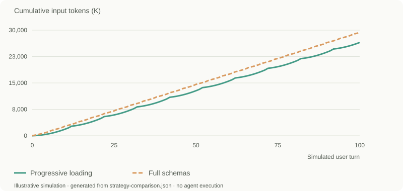

# MCP Token Lab

**Compare MCP agent strategies through multi-turn token simulations.**

Model tool-loading, caching and context-compression assumptions; inspect how they affect token usage and estimated cost. MCP Token Lab runs a deterministic accounting model in your browser. It does **not** run an agent, connect to MCP servers, call model APIs, tokenize real schemas, or measure task quality.

[中文说明](docs/README.zh-CN.md) · [Reproduce an experiment](docs/examples/README.md) · [Model and limitations](docs/simulation-model.md) · [Contribute](CONTRIBUTING.md)



*Documentation chart generated by the project engine, not a screenshot of the current UI. 100 simulated turns, 100 tools, 30 skills, 90% expected prefix-cache hit rate, 100K compression threshold. Input includes cached, fresh and compression requests; excludes output. Illustrative simulation, not measured agent execution. [Configuration and full conditions](docs/examples/README.md).*

## Quick start

Use **Node.js 22.12+ (22 LTS recommended)** and **pnpm 10.18.3**. The project also declares support for Node 20.19+; Node 18 cannot run the Vite 7 build. No API keys, backend or environment file are required.

```sh
git clone https://github.com/zhangHongEn/token-lab.git
cd token-lab
npm install --global pnpm@10.18.3
pnpm install --frozen-lockfile
pnpm dev --host 127.0.0.1
```

Open the local URL printed by Vite (normally `http://127.0.0.1:5173`; it may select another port if occupied). The app starts with the first built-in template and recalculates after valid edits; there is no “Run agent” button.

```sh
pnpm test
pnpm build
pnpm preview --host 127.0.0.1
```

The build writes static assets to `dist/`. `preview` serves the built app locally. The repository includes a GitHub Pages workflow; a successful local build does not establish that any public deployment is current. This README uses the repository and local start commands as the stable entry points.

## Try a reproducible comparison

```sh
node scripts/reproduce-example.mjs --check
```

This checks the committed JSON, CSV and SVG outputs against the actual simulation engine. To regenerate them after an intentional model change, omit `--check` and review the diff.

In the UI: **Templates → Import custom template → select `docs/examples/strategy-comparison.json` → Use template**. This replaces the current settings; export your work first if you want to retain it. Choose English or Chinese using the header language control.

1. Inspect **Global settings**: 100 turns, 100 tools, 30 skills, 90% prefix hit rate, 100K compression threshold and “Illustrative rates”.
2. Expand either plan to inspect its flow and settings. Full schemas load definitions initially; progressive loading adds a schema discovery request and schemas each turn.
3. Inspect the comparison table, session cost trend, cost attribution and individual requests. The documentation's cumulative-input chart is an additional derived view; the existing session-trend UI exposes cumulative and per-turn **cost**.
4. Change tools from 100 to 10, keeping everything else fixed. In this model the cost ordering reverses. Export the configuration to preserve the experiment.

| Fixed example | Progressive loading | Full schemas |
|---|---:|---:|
| Initial context (K tokens) | 8.3 | 59.3 |
| Cumulative input (K tokens) | 26,497.64 | 29,339.50 |
| Output (K tokens) | 186 | 236 |
| Simulated model requests, including compression | 409 | 324 |
| Compression events | 9 | 24 |
| Estimated cost, illustrative USD rates | $13.115365 | $14.866832 |

Rates are **invented for this experiment**, in USD per 1M tokens: cached input 0.20, fresh input 2.00, output 8.00. They are not a provider quote. These results do not establish equal answer quality or a fixed savings percentage. [Exact configuration, sensitivity results and reproduction](docs/examples/README.md).

## Available today

- Compare up to eight editable plans with shared settings and per-plan overrides. Automatic baseline selects the highest estimated cost; a manual baseline can be selected.
- Configure initial context and turn steps, token expressions, custom variables, disabled steps, interval triggers and deterministic probability triggers.
- Compare tool-loading, tool-search, namespace and result-shaping **templates**. Five built-in JSON templates are loaded from `src/config/default-template/`; they model assumptions, not integrations with hosted services.
- Model expected prefix caching and compression by context size or active user-turn count; inspect retained turns and compression costs.
- Inspect session totals, peak input, request counts, cost trends, source attribution and request-level context details.
- Use built-in **static pricing presets**, or custom rates in plan settings / imported configuration. A model selection sets accounting rates; it does not select a live model connection.
- Estimate elapsed time by adding configurable step durations. The existing “Avg. TTFT per turn” label is broader than measured TTFT: it sums modeled step durations, including compression, and is not a latency benchmark.
- Import/export JSON configurations, apply templates, copy/delete plans and undo the last recorded edit. English/Chinese display is available; custom names and some model labels may retain their original language.

## Assumptions that matter

All lengths use **K tokens = 1,000 tokens**. Prices use **USD per 1,000,000 tokens**. A repeated context token contributes again each time a modeled request consumes it; cumulative input is not the final context size.

Cache hits are expected-value allocations over a prefix matched by action identity, not observations from a provider. Even the first request treats initial context as eligible for the configured hit rate. Compression is checked **after a complete user turn**, may overshoot the threshold, and adds a billed model request—even after the last turn. Model context limits and pricing-tier transitions are not automatically enforced.

No tokenizer, schema ingestion, task-success measurement, actual parallel agent execution, rate-limit/retry simulation, provider billing reconciliation or production trace import is included. Built-in prices and currency conversion are static and may be stale; their stored “verified” dates are metadata, not a guarantee of current pricing. Read [the full accounting model](docs/simulation-model.md) before using results to make engineering decisions.

## Data and development

Simulation runs locally in a Web Worker. Configuration and imported templates are held in memory, so export them before refreshing; the language preference uses local storage. The current source has no application analytics collector or account system. This describes application code, not hosting access logs or browser extensions.

| Area | Source |
|---|---|
| Session accounting, cache and compression | `src/session.js` |
| Flow defaults, triggers and durations | `src/session-flow.js` |
| Validation and shared/plan configuration | `src/config.js`, `src/comparison.js` |
| Reports and worker | `src/session-report.js`, `src/session.worker.js` |
| Pricing snapshots | `src/model-pricing.js` |
| Templates | `src/config/default-template/` |
| Vue interface and charts | `src/components/`, `src/charts.js` |

Bug reports should include a minimal exported configuration, reproduction steps and expected vs actual behavior. See [CONTRIBUTING.md](CONTRIBUTING.md). The project is licensed under [MIT](LICENSE).

## Design and launch preparation

[Header design and review images](docs/design/README.md) · [30-day plan and 90-day direction](docs/marketing/plan.md) · [Draft launch materials](docs/marketing/launch-kit.md)

These are review materials. The proposed header, landing-page split, analytics and sharing features are not claims about the current app.
