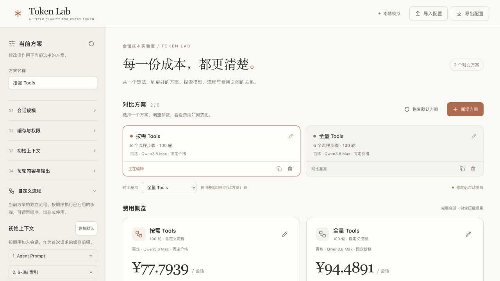

<div align="center">

# Token Lab

**在运行 Agent 之前，看清每一份 Token 成本。**

自定义会话流程 · 多方案成本对比 · 缓存与压缩模拟

Vue 3 · Vite · ECharts · Web Worker

[快速开始](#快速开始) · [核心功能](#核心功能) · [自定义流程](#自定义流程) · [计算与配置文档](docs/simulation.md)

</div>



## 为什么做 Token Lab？

一次 Agent 任务，通常包含多次模型调用。系统提示、工具定义、检索结果和历史消息会反复进入上下文；缓存命中率与压缩策略，也会改变最终账单。

Token Lab 是一个**可自定义流程的 Agent 会话成本模拟器**。你可以把会话拆成“追加内容”和“调用模型”两类步骤，为每一步设置预计 Token 用量，再比较不同方案的完整会话费用。

它帮助你回答：

- 工具定义放在初始上下文，还是在需要时查询，费用会差多少？
- 减少一次模型调用，能省下多少输入与输出成本？
- 缓存命中率变化，会怎样影响长会话的累计费用？
- 多久压缩一次上下文、保留几轮历史，更适合当前流程？
- 同一套流程，更换模型费率后的成本差异有多大？

**所有模拟在浏览器本地完成，无需 API Key，也不会调用真实模型。** 输入的是预计 Token 长度，结果用于方案估算；模型质量、实际延迟和真实缓存命中情况需要另行验证。

## 核心功能

| 功能 | 你可以做什么 |
| --- | --- |
| **多方案独立对比** | 同时比较最多 8 个方案，各自配置流程、参数和模型费率；支持新增、复制、删除与撤销删除。 |
| **两阶段流程编辑** | 分别设计初始上下文和每轮执行流程，自由增删、排序、改名或停用步骤。 |
| **参数化 Token 用量** | 为步骤设置固定长度、引用参数或参数乘积，例如“每轮工具数 × 单个工具返回长度”。 |
| **缓存与压缩模拟** | 设置前缀期望命中率；按轮次或 Token 阈值触发压缩，并配置保留轮次与摘要长度。 |
| **费用归因与请求追踪** | 查看每个来源的输入、输出与费用；通过趋势图和请求明细追踪会话变化。 |
| **配置与结果导出** | 用 JSON 保存或分享完整方案，用 CSV 导出请求记录与费用来源。 |

页面提供两套开箱即用的流程：**按需发现工具 Schema** 和 **初始预加载工具 Schema**。两者都是可编辑的普通方案，计算引擎统一按步骤执行，你也可以建立完全不同的流程。

## 快速开始

需要 **Node.js 20.19+ 或 22.12+**。

获取项目源码后，在项目目录运行：

```sh
npm install
npm run dev
```

打开终端显示的本地地址，即可开始对比。

1. **选一个方案**：先使用默认流程，或复制一份作为新的实验方案。
2. **调整参数与步骤**：在左侧配置模型费率、会话轮次、Token 用量和执行流程。
3. **选择对比基准**：查看总费用、费用差额、来源分布和会话趋势。
4. **保存实验**：导出 JSON 留存配置，或导出 CSV 分析结果。

配置保存在当前页面内存中，刷新页面会恢复默认值；需要保留的方案请先导出 JSON。

## 自定义流程

一次会话由两个阶段组成：

```text
initial：建立初始上下文
    ↓
turn：追加用户消息 → 模型生成计划 → 追加工具结果 → 模型生成回复
    ↓
检查压缩阈值 → 必要时调用模型生成摘要
    ↓
进入下一轮，直到完成设定轮次
```

每个步骤只需描述名称、类型和 Token 长度。下面是一段可在项目根目录通过 Node.js ES Module 运行的示例：

```js
import Session from "./src/session.js";

const session = new Session({
  turnTotalCount: 10,
  expectedPrefixCacheHitRate: 0.9,
  // 示例单价，单位：货币 / 百万 Token；请替换为所用模型的费率。
  model: {
    inputCachedPrice: 1.5,
    inputNotCachedPrice: 12,
    outputPrice: 36,
  },
  flow: {
    initial: [
      { type: "action", text: "系统提示", token: 2 },
      { type: "action", text: "业务背景", token: 1 },
    ],
    turn: [
      { type: "action", text: "用户提问", token: 0.1 },
      { type: "llm", text: "检索计划", token: 0.2 },
      { type: "action", text: "检索结果", token: 3 },
      { type: "llm", text: "最终回复", token: 1 },
    ],
  },
});

session.reset();
const totals = session.getConsumptionTokens();
console.log("预计会话费用：", totals.totalPrice);
```

- `action`：向上下文追加内容，例如系统提示、用户消息或工具返回。
- `llm`：以当前有效上下文作为输入，生成指定长度的输出，并追加到上下文。
- `token`：以 **K Token** 为单位；`1` 表示 1,000 Token。
- `enabled: false`：跳过步骤，方便比较删减某一步后的效果。

初始阶段支持 `action`，每轮阶段支持 `action` 和 `llm`。流程是纯 JSON 数据，可在页面、配置文件和 Worker 之间传递。

更多参数、缓存匹配规则和压缩细节，见 [会话模拟与配置参考](docs/simulation.md)。

## 如何理解结果

```text
请求费用 = 命中输入 K ÷ 1,000 × 命中输入单价
         + 未命中输入 K ÷ 1,000 × 未命中输入单价
         + 模型输出 K ÷ 1,000 × 输出单价

会话总费用 = 所有普通请求费用 + 所有压缩请求费用
```

- **上下文会累积**：后续调用会重新读取当前有效上下文，一段内容可能产生多次输入费用。
- **缓存按前缀匹配**：引擎按动作引用匹配输入前缀，再应用配置的期望命中率；首次请求的初始上下文也按该期望值估算。
- **压缩本身也收费**：每轮流程结束后检查阈值，压缩请求的输入和摘要输出均计入总费用，包括最后一轮触发的压缩。
- **对比口径要一致**：方案需使用相同币种；轮次数不同，比较的是各自完整会话的总费用。
- **模型费率是快照**：内置费率不会联网更新，可在页面中手动调整。模拟器不会对真实文本进行分词计数。

## 本地验证与构建

```sh
# 运行计算、流程、配置迁移与多方案测试
npm test

# 仅构建静态页面
npx vite build

# 预览构建产物
npm run preview
```

当前仓库的 `npm run build` 包含 CDN 上传步骤。本地开发和验证请使用 `npx vite build`。

## 项目结构

```text
src/
├── session.js             # 通用流程执行、缓存、压缩与计费
├── session-defaults.js    # 默认会话参数
├── session-flow.js        # 流程模板、Token 参数与步骤校验
├── session-report.js      # 请求记录、费用归因与会话汇总
├── session.worker.js      # 在 Worker 中执行模拟
├── comparison.js          # 独立方案、对比基准与配置校验
├── config.js              # 参数表单定义与配置读取
├── legacy-config.js       # 旧配置转换为独立流程
├── model-pricing.js       # 内置模型费率快照
├── components/            # 参数、流程、概览与分析界面
├── charts.js              # 费用来源与会话趋势图
├── export.js              # CSV 导出
└── App.vue                # 页面状态与方案管理
```

配置采用 v4 格式，导入时兼容 v2 / v3；旧模式条件会被转换成实际流程步骤。完整格式见 [配置参考](docs/simulation.md)。

## 参与改进

欢迎讨论新的流程模板、费用展示方式和模拟边界，也欢迎提交修复。

反馈计算问题时，请附上可复现的配置、预期结果与实际结果；分享前移除不希望公开的方案名称和自定义内容。更新模型费率时，请注明价格来源、币种、适用档位和核对日期。

修改计算逻辑后运行 `npm test`，修改界面后再检查 `npx vite build`，并确认相关交互正常。
