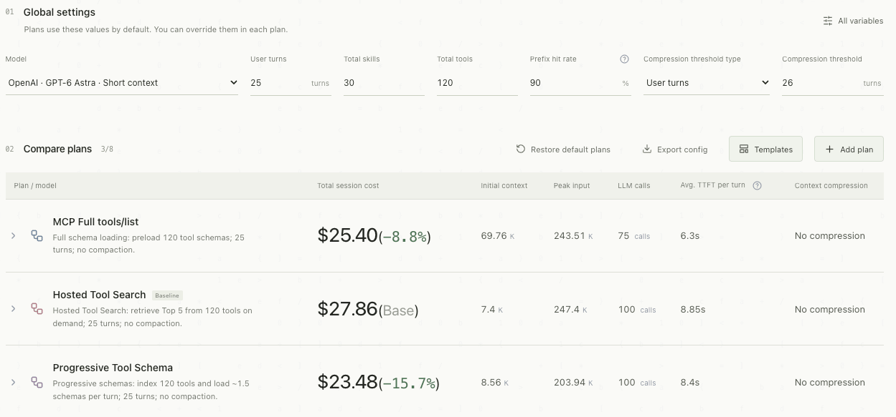
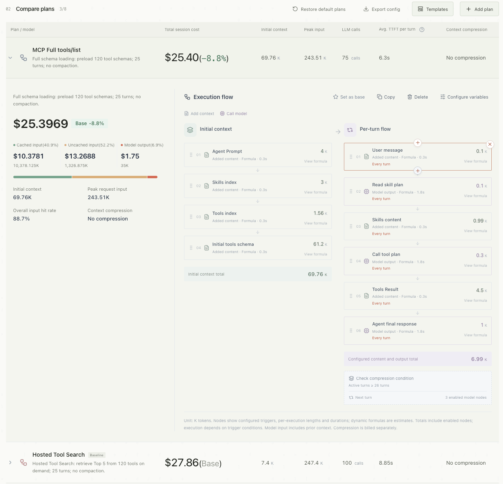
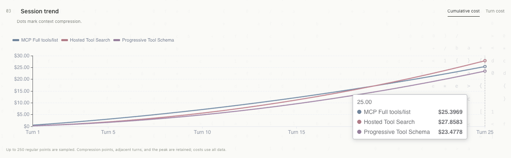
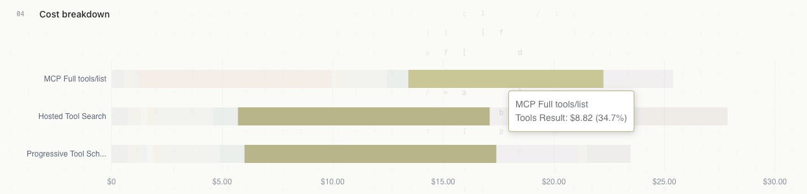
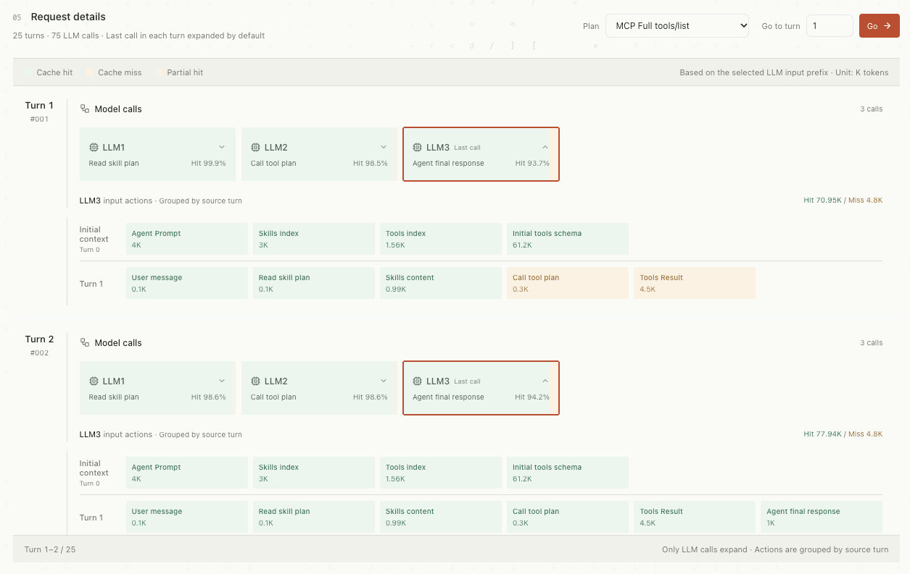
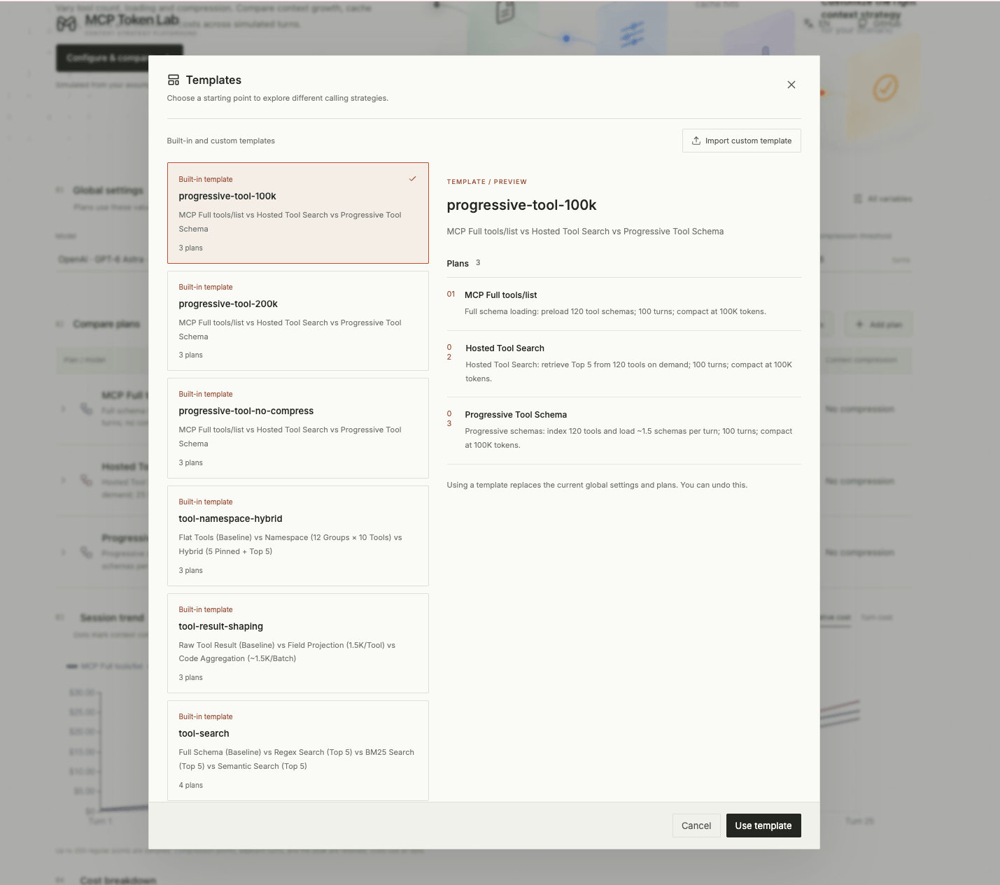

<div align="center">

# MCP Token Lab

**Your agent. Your context strategy.**

An interactive playground for exploring how **MCP tool loading, context growth, prefix caching, and compression** change token usage and estimated LLM costs across multi-turn agent sessions.

[**Live demo**](https://eilumie.github.io/mcp-token-lab/) · [中文文档](docs/README.zh-CN.md)

</div>

## Why MCP Token Lab?

As an agent gains tools and takes more turns, its context can become expensive. Should you preload every tool schema, discover tools on demand, or selectively load schemas? How much could prefix caching help? When does context compression pay for itself?

MCP Token Lab makes those trade-offs **visible, configurable, and comparable** without an API key, backend, or cloud account. Change a parameter and see the model recalculate.

- **Compare strategies** — full tool-schema loading, progressive schema loading, tool-search and related scenario templates.
- **Tune the workload** — turns, tool/skill counts, token sizes, custom variables and per-plan overrides.
- **Inspect the mechanics** — initial context, per-turn steps, model requests, caching and compression.
- **Understand the bill** — total cost, token attribution, trend lines, peak input and request-level breakdowns.

## Feature tour

### 01 · Configure and compare strategies

Use **Global settings** to set model pricing, session turns, skill and tool counts, expected prefix-cache hit rate, and compression thresholds. Compare **up to eight plans** side by side by total session cost, initial context, peak request input, LLM calls, modeled per-turn timing, and compression. Plans inherit global settings by default but can override them; choose an automatic or manual baseline.



### 02 · Design each plan's execution flow

Expand any plan to inspect its cost summary, **initial context**, and **per-turn execution flow**. Add context actions and LLM calls, edit token expressions, variables and step durations, and use interval or probability triggers to model schema discovery, tool results, and agent responses.



### 03 · Track session cost trends

Switch between **cumulative cost** and **per-turn cost** to see how strategies evolve across a conversation. The chart can mark context-compression events.



### 04 · Attribute the cost

Use the stacked **Cost breakdown** chart to identify the contribution of tool schemas, skill context, tool results, model outputs, and other sources to estimated session spending.



### 05 · Inspect prefix caching and requests

In **Request details**, select a plan, jump to a turn, and expand individual LLM calls. Trace input context grouped by source turn and distinguish **cache hits**, **cache misses**, and **partial hits** for each request.



### 06 · Choose a starting template

Open **Templates** to browse six built-in strategy scenarios and preview their plans before applying one. Import a custom JSON template from the dialog, or export the current configuration from the plan toolbar. The interface supports English and Chinese.



## Built-in strategy templates

Open **Templates** in the plan toolbar, select a template, review its plans, then click **Use template**. Each template provides editable settings and workflows. Applying one replaces the current settings and plans; you can undo that change or export your configuration first.

| Template | Strategies compared | What to explore |
|---|---|---|
| [`progressive-tool-no-compress`](src/config/default-template/progressive-tool-no-compress.json) **(startup default)** | MCP Full tools/list · Hosted Tool Search · Progressive Tool Schema | Compare schema-loading approaches over 25 turns without compression. |
| [`progressive-tool-100k`](src/config/default-template/progressive-tool-100k.json) | Same three loading strategies | Explore how a **100K-token** compression threshold affects context growth and cost over 100 turns. |
| [`progressive-tool-200k`](src/config/default-template/progressive-tool-200k.json) | Same three loading strategies | Contrast a higher **200K-token** compression threshold over 100 turns. |
| [`tool-search`](src/config/default-template/tool-search.json) | Full Schema · Regex Search · BM25 Search · Semantic Search (Top 5 each) | Compare full preload with modeled Top-5 discovery and selective schema loading. |
| [`tool-namespace-hybrid`](src/config/default-template/tool-namespace-hybrid.json) | Flat Tools · Namespace (12 groups × 10 tools) · Hybrid (5 pinned + Top 5) | Explore namespace grouping, periodic discovery, and keeping frequently used tool schemas loaded. |
| [`tool-result-shaping`](src/config/default-template/tool-result-shaping.json) | Raw Tool Result · Field Projection (1.5K/tool) · Code Aggregation (~1.5K/batch) | Compare how trimming or aggregating tool results changes context size and estimated cost. |

All six templates are stored as JSON files in [`src/config/default-template/`](src/config/default-template/) and can be customized in the interface.

## AI assistant Skill: generate custom scenarios

This repository also includes **[`mcp-token-lab`](skills/mcp-token-lab/SKILL.md)**, an Agent Skill for generating importable comparison JSON with an AI coding assistant. Describe your Agent workflow and the strategies you want to compare—tool-schema loading, caching, compression, model pricing assumptions, or step durations. The Skill runs in your AI assistant; it is **separate from the six built-in templates** in the web app.

**Set up:** Install or register the [`skills/mcp-token-lab/`](skills/mcp-token-lab/) directory with an Agent Skills-compatible assistant according to its instructions. If named Skill invocation is supported, use a prompt such as:

```text
Use $mcp-token-lab to generate an importable JSON template comparing
full MCP tool-schema preloading with on-demand discovery for 100 tools
over 100 user turns. Keep model pricing identical between plans and
explain the assumptions.
```

**Validate:** With the project dependencies installed, run this from the repository root, replacing `my-scenario.json` with the generated file:

```bash
node skills/mcp-token-lab/scripts/validate-config.mjs --repo . ./my-scenario.json --simulate --strict
```

The checker uses the application's importer, runs the complete simulation, and rejects unresolved or invalid description placeholders. Once valid, open the [live app](https://eilumie.github.io/mcp-token-lab/), select **Templates → Import custom template**, choose the JSON, then click **Use template**. Applying a template replaces current settings and plans (with an undo option).

See the [format reference](skills/mcp-token-lab/references/import-format.md) and [sample template](skills/mcp-token-lab/assets/comparison.example.json). No Skill installation is required for the web app's built-in templates.

## Quick start

**Requirements:** Node.js **22.12+ recommended** (Node 20.19+ is declared supported) and **pnpm 10.18.3**. No API key, environment file or backend is needed.

```bash
git clone https://github.com/Eilumie/mcp-token-lab.git
cd mcp-token-lab
npm install --global pnpm@10.18.3
pnpm install --frozen-lockfile
pnpm dev --host 127.0.0.1
```

Open the address printed by Vite (normally `http://127.0.0.1:5173`). The app loads a built-in template and automatically recalculates after valid edits. There is no agent execution button.

```bash
pnpm test
pnpm build
pnpm preview --host 127.0.0.1

```

The production build is generated in `dist/` and can be served as static files.

## Under the hood

| Layer | Implementation |
|---|---|
| Interface | Vue 3, Vite 7, Lucide Vue |
| Charts | Apache ECharts 6 |
| Simulation engine | JavaScript modules (`src/session.js`, `src/session-flow.js`) |
| Aggregation and reporting | `src/session-report.js`, `src/comparison.js` |
| Background computation | Web Worker (`src/session.worker.js`) |
| Scenario templates | `src/config/default-template/` |

The simulation runs locally in your browser. Current configuration is not persisted between reloads; export it if needed. There is no application account system or analytics collector in the current source.

## Contributing

Issues, bug reports, reproducible scenario files and pull requests are welcome. Include the exported configuration, steps to reproduce, and expected versus actual results. Discuss contributions in [GitHub Issues](https://github.com/Eilumie/mcp-token-lab/issues).

## License

[MIT](LICENSE) © contributors.

---

<div align="center">
  <a href="https://eilumie.github.io/mcp-token-lab/">Explore the simulator</a> ·
  <a href="https://github.com/Eilumie/mcp-token-lab/issues">Report an issue</a>
</div>