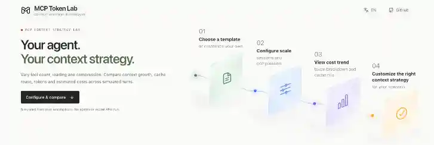
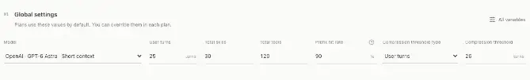
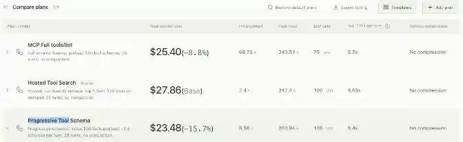
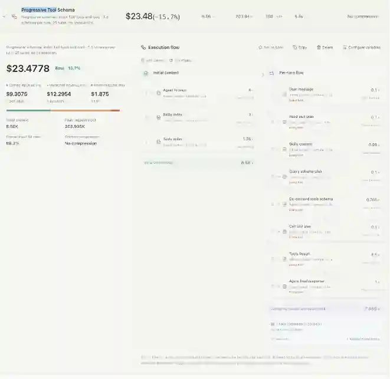
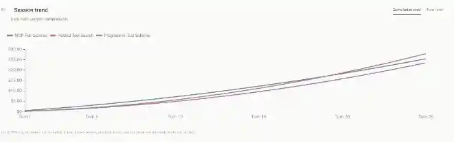
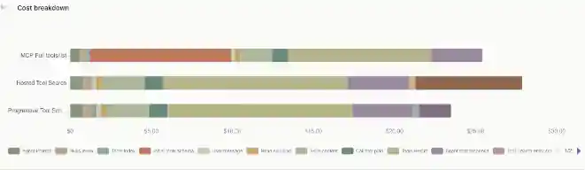
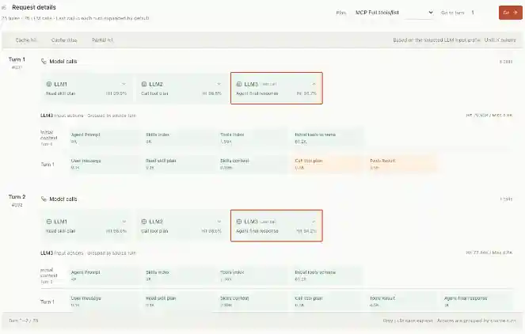
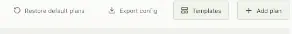

<div align="center">

# MCP Token Lab

**你的 Agent，你的上下文策略。**

在浏览器里模拟并对比 **MCP 工具加载、上下文增长、前缀缓存与上下文压缩** 对多轮 Agent 会话 Token 消耗及预估成本的影响。

[**在线体验**](https://zhanghongen.github.io/mcp-token-lab/) · [English README](../README.md) · [可复现实验](examples/README.md) · [模拟模型与边界](simulation-model.md)



</div>

## 它能解决什么问题？

当 Agent 接入的工具越来越多、会话越来越长时，开发者需要判断：**全量加载工具 Schema，还是按需发现？缓存是否能抵消更大的上下文？压缩策略什么时候值得启用？**

MCP Token Lab 将这些问题变成一组可以修改、对比、复现的模拟实验，无需 API Key、后端或注册账号。

## 功能一览

### 01 · 全局参数与模型费率

设置会话轮数、工具和技能数量、前缀缓存预期命中率以及压缩触发条件。可以选择静态模型价格预设，也可以通过方案配置使用自定义费率。



**说明：** 选择模型仅用于估算费用，不会连接该模型。内置费率为静态快照，不能保证始终为当前报价。

### 02 · 最多八个方案对比

同时比较全量工具 Schema、渐进式 Schema 加载、工具搜索等模板策略。展示总费用、初始上下文、峰值请求输入、调用次数及模型化耗时，并支持自动或手动指定对比基准。



**说明：** 图中的百分比只对当前参数和基准方案有效，不代表真实项目中可确保节省的比例。

### 03 · 可编辑执行流程

为每个方案设置初始上下文与逐轮流程。可配置上下文动作、LLM 请求、Token 计算表达式、自定义变量、步骤持续时间，以及固定间隔或确定性概率触发条件。



### 04 · 会话成本趋势

按多轮会话查看累计费用和单轮费用，观察不同策略的成本曲线如何变化，包括上下文反复使用和压缩触发带来的影响。



### 05 · 成本来源拆解

通过堆叠图拆分工具 Schema、技能上下文、用户消息、工具结果、模型输出等组成部分，判断成本主要来自哪里。



### 06 · 逐请求 Token 明细

展开每轮会话，检查单次 LLM 请求的上下文组成、缓存命中、缓存未命中及部分命中情况，追踪具体 Token 来源。



### 07 · 模板、配置导入导出与中英文界面

内置五种 JSON 模板，可导入自定义模板、导出当前配置、恢复默认方案，也支持中英文切换。



**说明：** 此图展示操作入口，没有展示弹窗内容。当前方案配置保存在内存中，刷新前需要手动导出；语言偏好存储在本地。

## 一个可复现的对比实验

仓库提供固定配置：100 轮会话、100 个工具、30 个技能、90% 预期前缀缓存命中率、100K 压缩阈值。成本计算使用**人为设定的示例费率**，不代表任何厂商当前价格。

| 指标 | 渐进加载 | 全量 Schema |
|---|---:|---:|
| 初始上下文 | 8.3K | 59.3K |
| 累计输入（缓存 + 未缓存） | 26,497.64K | 29,339.50K |
| 模拟模型请求（含压缩） | 409 | 324 |
| 压缩次数 | 9 | 24 |
| 预估费用 | **$13.115365** | **$14.866832** |

**不要把这组结果理解成“渐进加载总是更省”。** 同一实验只把工具数从 100 改为 10，费用排序就会反转：全量 Schema 策略反而更便宜。不同策略的模拟请求数量也不相同，更不能据此断言任务完成质量一致。


## 本地运行

推荐 **Node.js 22.12+**（项目声明支持 Node 20.19+）以及 **pnpm 10.18.3**。

```bash
git clone https://github.com/zhangHongEn/mcp-token-lab.git
cd mcp-token-lab
npm install --global pnpm@10.18.3
pnpm install --frozen-lockfile
pnpm dev --host 127.0.0.1
```

按 Vite 终端输出的地址访问（通常为 `http://127.0.0.1:5173`）。修改有效参数后会自动重算，不需要执行真实 Agent。

```bash
pnpm test
pnpm build
pnpm preview --host 127.0.0.1
node scripts/reproduce-example.mjs --check
```

## 模拟原理与局限

模拟器根据初始上下文、每轮步骤和模型请求构建 Token 核算记录，按配置的缓存命中率、压缩规则及费率汇总费用。

```text
单次请求费用（USD）=
  （缓存输入 K × 缓存费率
   + 未缓存输入 K × 输入费率
   + 输出 K × 输出费率）/ 1000
```

- **单位：** 1K = 1,000 Token；模型费率单位为美元 / 100 万 Token。
- **缓存：** 是按期望值分摊的假设，不是实际厂商缓存命中统计。
- **压缩：** 在完整用户轮结束后检查条件，压缩本身会增加一次计费模型请求。
- **耗时：** 由各步骤设定时长求和。界面当前“平均每轮 TTFT”并非实测首 Token 延迟。
- **不包含：** 真实分词、真实模型调用、质量评估、生产轨迹导入、上下文窗口强制限制、价格档位自动切换及实际账单核对。

详见 [模拟模型、假设与限制](simulation-model.md)。

## 技术栈

- **前端：** Vue 3、Vite 7、Lucide Vue
- **图表：** Apache ECharts 6
- **模拟引擎：** JavaScript（`src/session.js`、`src/session-flow.js`）
- **计算：** Web Worker（`src/session.worker.js`）
- **场景模板：** `src/config/default-template/`

模拟过程在浏览器内完成。当前版本没有应用内账号体系或埋点收集器，编辑的配置默认不会跨刷新保存。

## 参与贡献

欢迎反馈问题、提供可复现配置和提交 PR。报告问题时请尽量附带配置 JSON、复现步骤、预期结果与实际结果。可以通过 [GitHub Issues](https://github.com/zhangHongEn/mcp-token-lab/issues) 讨论。

## 开源协议

[MIT](../LICENSE) © contributors.